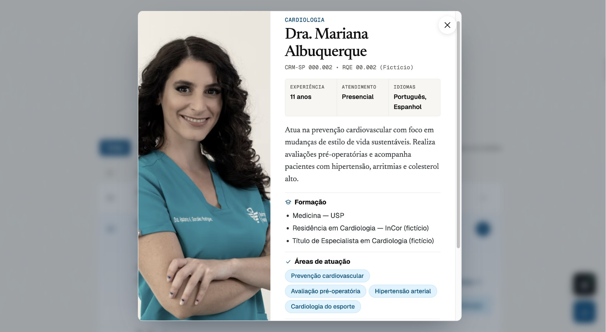
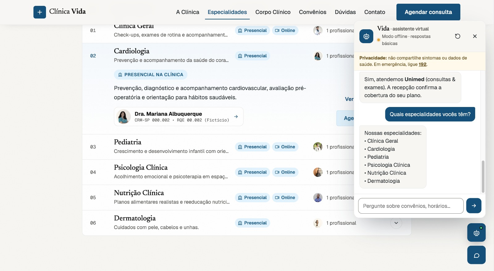
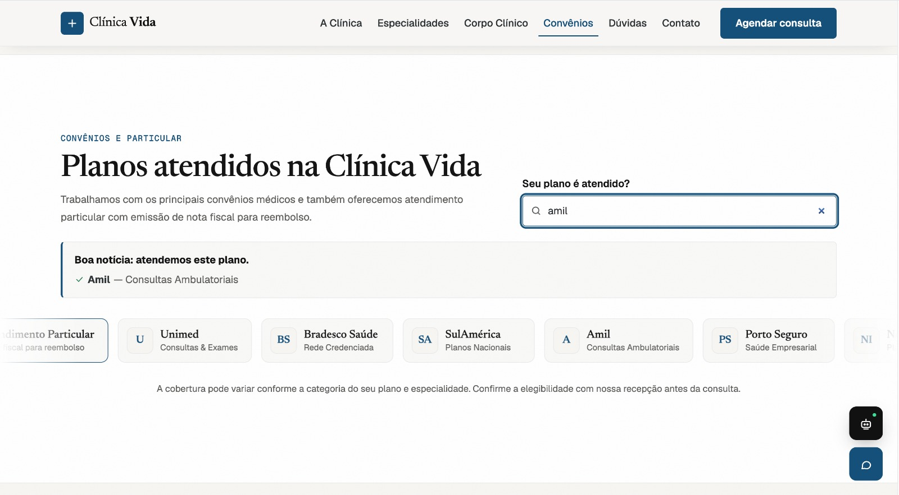
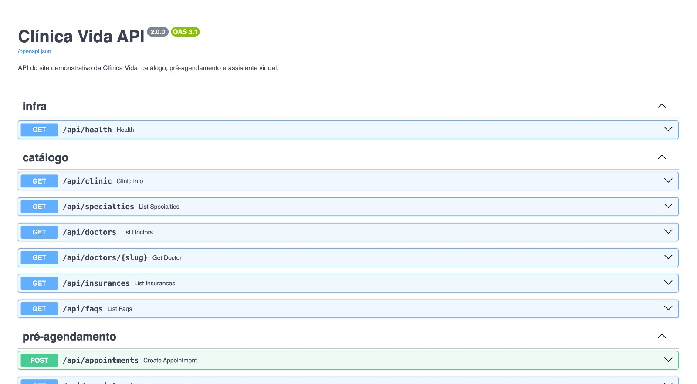

# Clínica Vida — Site + API FastAPI + Assistente Virtual (v2)

**[🔗 Ver demo online](https://github.com/AquilesMBoni/ClinicaVida)** · [Como executar](#como-executar) · [Endpoints](#endpoints)

> A demo online (GitHub Pages) roda em **modo offline**: o site e a assistente usam dados locais e o pré-agendamento não é gravado. Para a experiência completa (API, banco SQLite e Swagger), execute o projeto localmente.


Landing page institucional de uma clínica multidisciplinar fictícia, agora com **backend em FastAPI**, **banco SQLite** e uma **assistente virtual ("Vida")**. Mantém o foco em acolhimento, acessibilidade (WCAG 2.2), LGPD e Resolução CFM nº 2.336/2023.

## Novidades da v2

**Front-end**
- **Hero com efeito de escrita** em duas frases ("Cuidado integral." / "Em *cada fase* da sua vida."), sem salto de layout e legível por leitores de tela.
- **Carrossel automático no hero**: troca de imagens com fade + zoom suave, legenda sincronizada, indicadores, botão de pausa (WCAG 2.2.2), pausa no hover/foco, setas do teclado e gesto de arrastar no celular.
- **Tabela dinâmica de especialidades**: linhas compactas que expandem (uma por vez) mostrando modalidade, descrição, profissionais, "Ver especialistas" e "Agendar". Filtro Todas / Presencial / Online.
- **Perfil do profissional em modal**: clicar na foto abre a ficha completa (formação, áreas de atuação, idiomas, agenda) sobre a página, com **fundo desfocado** e botão de fechar.
- **Infinite Logo Carousel** de convênios (logotipos tipográficos ilustrativos, sem marcas reais), com pausa no hover, e busca "Seu plano é atendido?".
- **Assistente sempre visível** (botão flutuante junto ao "Fale conosco" e na barra inferior do celular) + **atalho na seção de Perguntas Frequentes**.
- **Scroll Reveal no site inteiro** (respeita `prefers-reduced-motion`).
- Formulário envia para a API, mostra **protocolo** (ex.: `CV-H79PEN`) e destaca erros por campo.

**Back-end**
- FastAPI + SQLAlchemy 2 + SQLite, com seed automático na primeira execução.
- Mesmas regras de negócio do formulário validadas no servidor (domingo fechado, sábado só manhã, modalidade por profissional etc.).
- Limite de requisições por IP e rota administrativa protegida por token.

**Assistente virtual**
- Motor de intenções em português (sem acento/maiúsculas) usando o próprio banco como base de conhecimento: especialidades, profissionais, agenda, convênios, horários, localização, valores, FAQ e status de protocolo.
- Respostas com **ações** (agendar já preenchendo o formulário, abrir perfil, filtrar equipe).
- **Guardrails**: sinais de emergência → SAMU 192; sofrimento emocional → CVV 188; nunca faz diagnóstico nem indica remédio.
- **LLM opcional** (Ollama, LM Studio ou qualquer API compatível com OpenAI) usado só quando regras e FAQ não acham resposta.
- Conversas **não são armazenadas** (LGPD). Sem servidor, o site entra em modo offline com respostas básicas.

## Telas

| Especialidades (tabela expansível) | Perfil do profissional (modal com desfoque) |
|---|---|
|  |  |

| Assistente virtual | Convênios (carrossel infinito) |
|---|---|
|  |  |

| Versão celular | Documentação da API (Swagger) |
|---|---|
|  |  |

## Como executar

**Windows (PowerShell)**

```powershell
cd backend
py -m venv .venv
.venv\Scripts\Activate.ps1
pip install -r requirements.txt
uvicorn app.main:app --reload
```

> Se o PowerShell bloquear o `Activate.ps1`, rode uma vez: `Set-ExecutionPolicy -Scope CurrentUser RemoteSigned`.
> Sem ambiente virtual, use `py -m uvicorn app.main:app --reload`.

**Linux / macOS**

```bash
cd backend
python3 -m venv .venv
source .venv/bin/activate
pip install -r requirements.txt
uvicorn app.main:app --reload
```

- Site: <http://127.0.0.1:8000>
- Documentação interativa da API: <http://127.0.0.1:8000/docs>

O banco `backend/clinicavida.db` é criado e populado automaticamente. Para recriá-lo: `py -m app.seed --reset` (Linux/macOS: `python3 -m app.seed --reset`).

Também funciona abrindo `frontend/index.html` com o **Live Server** (porta 5500): o site chama a API em `http://127.0.0.1:8000`. Se a API estiver desligada, usa `js/fallback-data.js` (modo offline).

### LLM opcional (ex.: Ollama local)

Copie `backend/.env.example` para `backend/.env` e preencha:

```env
LLM_BASE_URL=http://localhost:11434/v1
LLM_MODEL=llama3.2
```

### Testes

```bash
cd backend
pytest
```

### Publicar a demo (GitHub Pages)

```powershell
git subtree push --prefix frontend origin gh-pages
```

## Endpoints

| Método | Rota | Descrição |
|---|---|---|
| GET | `/api/health` | Status da API |
| GET | `/api/clinic` | Endereço, contatos e horários |
| GET | `/api/specialties` | Especialidades com profissionais |
| GET | `/api/doctors?specialty=` | Profissionais (filtro opcional) |
| GET | `/api/doctors/{slug}` | Perfil completo |
| GET | `/api/insurances` | Convênios |
| GET | `/api/faqs` | Perguntas frequentes |
| POST | `/api/appointments` | Cria pré-agendamento e devolve protocolo |
| GET | `/api/appointments/{protocolo}` | Status (sem nome/telefone) |
| GET | `/api/appointments` | Lista da recepção (cabeçalho `X-Admin-Token`) |
| POST | `/api/assistant/chat` | Conversa com a assistente |
| GET | `/api/assistant/status` | Assistente online / LLM ativo |

## Estrutura

```text
ClinicaVida/
├── README.md
├── frontend/
│   ├── index.html
│   ├── css/style.css
│   └── js/
│       ├── api.js            # cliente da API + fallback offline
│       ├── script.js         # hero, tabela, modal, convênios, formulário, reveal
│       ├── assistant.js      # widget da assistente
│       └── fallback-data.js  # gerado por: python -m app.export_fallback
└── backend/
    ├── requirements.txt
    ├── .env.example
    ├── app/
    │   ├── main.py           # FastAPI + arquivos estáticos
    │   ├── config.py · database.py · models.py · schemas.py · security.py
    │   ├── seed.py · seed_data.py · export_fallback.py
    │   ├── routers/          # catalog, appointments, assistant
    │   └── assistant/        # engine (regras/FAQ), llm (opcional), text
    └── tests/                # pytest (API + assistente)
```

Ao alterar `seed_data.py`, rode `python -m app.seed --reset` e `python -m app.export_fallback` para manter banco e modo offline sincronizados.

## Observações legais e de portfólio

Todos os nomes, registros profissionais (`CRM`, `RQE`, `CRP`, `CRN`), endereço, telefone, e-mail, depoimentos e o link de WhatsApp (`5519000000000`) são fictícios e demonstrativos. Os "logotipos" de convênios são apenas monogramas tipográficos, não as marcas oficiais. Antes de usar em produção, substitua por dados oficiais autorizados e troque o `ADMIN_TOKEN`.

## Autor

Aquiles Miranda Bonifácio
